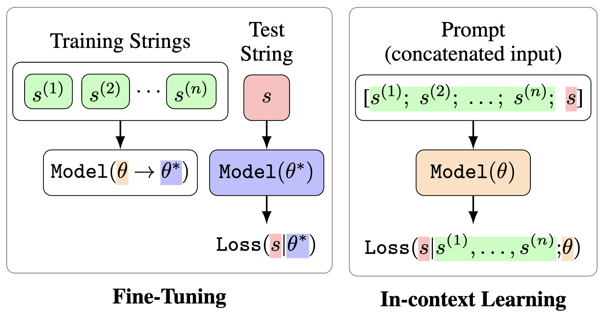
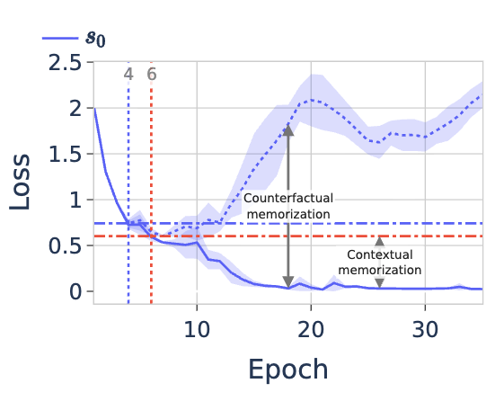

## Understanding the Foundations of Large Language Models via Formal Language Learning

Corresponding papers:

- Bishwamittra Ghosh, Soumi Das, Till Speicher, Qinyuan Wu, Mohammad Aflah Khan, Deepak Garg, Krishna P. Gummadi, and Evimaria Terzi. **Fine-tuning vs. in-context learning in large language models: A formal language learning perspective**. In Proc. ACL, 2026 (SAC highlight). URL: https://arxiv.org/abs/2604.23267

<p align="center"></p>

- Bishwamittra Ghosh, Soumi Das, Qinyuan Wu, Mohammad Aflah Khan, Deepak Garg, Krishna P. Gummadi, and Evimaria Terzi. **Understanding the interplay between memorization and learning in large language models**. In Proc. NeurIPS, 2026 (ED track).

<p align="center"></p>


## Installation

The code is tested on Python 3.10.

```
pip install -r requirements310.txt
```

Core dependencies: `transformers`, `accelerate`, `datasets`, `nltk`, `torch`, `deepspeed`, `wandb`, `scikit-learn`, `plotly`.


## Benchmark Datasets

The pre-generated formal language benchmarks are published on Hugging Face:

**https://huggingface.co/datasets/formallm/formal-grammar-llm-benchmark**

```python
from datasets import load_dataset

ds = load_dataset(
    "formallm/formal-grammar-llm-benchmark",
    name="pcfg_cfg3b_eq_len_skewed_prob",
)
print(ds["train_sequences"][0])
```

The datasets are not tracked in this repository. They can be downloaded from the link
above, or regenerated locally from grammar specifications (see [Data Generation](#data-generation));
regenerated datasets are written to `grammar_learning/data/`.

### Splits

Datasets are procedurally generated from grammar specifications. Each dataset includes:

| Split | Description |
|---|---|
| `train_sequences` | Sequences sampled from the grammar's distribution; used for fine-tuning |
| `test_sequences` | Held-out grammatically correct sequences not seen during training |
| `edit_distance_sequences` | Grammatically incorrect sequences at certain distances from the correct sequence |
| `grammar_edit_sequences` | Sequences modified by grammar rule edits; tests rule-level generalization |
| `incorrect_random_sequences` | Randomly generated grammatically incorrect sequences |

### Grammars

| Dataset Name | Grammar Type | Alphabet | Notes |
|---|---|---|---|
| `pcfg_4_3_1_2_3_4_5_6_7_8_9` | PCFG | `{1,…,9}` (10 terminals) | Base PCFG benchmark |
| `pcfg_4_3_1_2_3_4_5_6_7_8_9_eq_len_uniform_prob` | PCFG | `{1,…,9}` | Equal-length sequences, uniform rule probabilities |
| `pcfg_4_3_1_2_3_4_5_6_7_8_9_eq_len_skewed_prob` | PCFG | `{1,…,9}` | Equal-length sequences, skewed rule probabilities |
| `pcfg_4_3_1_2_3_4_5_6_7_8_9_latin` | PCFG | Latin alphabet | Alphabet-transfer variant |
| `pcfg_cfg3b_disjoint_terminals` | PCFG (3-branch) | `{1,…,9}` | Variable-length productions; terminals partitioned into 3 disjoint groups, uniform probabilities |
| `pcfg_cfg3b_eq_len_uniform_prob` | PCFG (3-branch) | `{1,…,9}` | Equal-length sequences, uniform probabilities |
| `pcfg_cfg3b_eq_len_skewed_prob` | PCFG (3-branch) | `{1,…,9}` | Equal-length sequences, skewed probabilities |
| `pcfg_cfg3b_disjoint_terminals_latin` | PCFG (3-branch) | Latin (disjoint) | Terminals disjoint from model's natural language tokens |
| `pcfg_max-depth_4_max-breadth_4_rules_2_skewness_1_alphabet_0-1-2-3-4` | PCFG | `{0,…,4}` | Controlled depth/breadth, small alphabet |
| `pcfg_max-depth_3_max-breadth_9_rules_9_skewness_10_alphabet-size_20_large` | PCFG | 20 terminals | Large grammar; depth 3, breadth 9, 9 rules per non-terminal, highly skewed probabilities (skewness 10), large corpus |

Each locally generated dataset directory contains:
- `meta_data_*.pkl` — sequence metadata (lengths, parse trees, rule applications)
- `grammar_meta_data_*.pkl` — grammar object and rule specifications
- `sequences_w_edit_distance_*.pkl` — pre-computed edit distance variants
- `meta_data_grammar_edit_*.pkl` — grammar-perturbation evaluation sequences
- `meta_data_lexer_edit_*.pkl` — lexer-level edit variants

The schema of the published Hugging Face dataset, and how it maps onto these files,
is documented in [convert_to_parquet.py](hf_upload/convert_to_parquet.py).

**Visualize the data with the [notebook](grammar_learning/benchmark/visualize_grammar.ipynb)**.


## Models

The benchmark is evaluated with the following LLMs via the HuggingFace `transformers` library:

| Model Family | Sizes | HuggingFace ID |
|---|---|---|
| **Pythia** | 1B, 2.8B, 6.9B | `EleutherAI/pythia-{1b,2.8b,6.9b}` |
| **Llama-3** | 1B, 3B, 8B | `meta-llama/Llama-3.2-{1B,3B}`, `meta-llama/Meta-Llama-3-8B` |
| **Llama-3.1** | 8B | `meta-llama/Meta-Llama-3.1-8B` |
| **Llama-2** | 7B, 13B | local checkpoint |
| **Mistral** | 7B, 12B | `mistralai/Mistral-7B-v0.3`, `mistralai/Mistral-Nemo-Base-2407` |
| **Gemma-2** | 2B, 9B | `google/gemma-2-{2b,9b}` |
| **Qwen-2.5** | 0.5B, 1.5B, 7B, 14B | `Qwen/Qwen2.5-{0.5B,1.5B,7B,14B}` |
| **OPT** | 1.3B, 2.7B, 6.7B | local checkpoint |

All models are evaluated in the **causal language modeling** regime. Fine-tuning uses character-level tokenization for formal language sequences by default, mapping grammar symbols to the model's token vocabulary. An option to use model-native tokenization (`--map_to_model_specific_tokens`) is also available.

Local checkpoint paths are placeholders (`/path/to/...`) in [config.py](grammar_learning/training/config.py)
and [exp_meta_data.py](grammar_learning/read_output/exp_meta_data.py); set them to your own model directories.


## Data Generation

- Strings generation from formal grammar: [notebook](grammar_learning/benchmark/data_generation.ipynb) or [script](grammar_learning/benchmark/generate_dataset.py) (`--grammar_name <name>`)
- Preparation for counterfactual training: [notebook](grammar_learning/benchmark/counterfactual_benchmark.ipynb)

## Training

- Sample bash scripts are in this [directory](grammar_learning/training/todo_and_log/)

### Processing Results

- Run the [python script](grammar_learning/read_output/process_results.py)


## Directory Structure

```
.
├── Dockerfile                          # Docker build file (PyTorch 2.4.1 / CUDA 12.1)
├── requirements310.txt                 # Python 3.10 dependencies
├── grammar_learning/
│   ├── benchmark/
│   │   ├── pcfg.py                     # PCFG class (extends NLTK PCFG with generation support)
│   │   ├── pcsg.py                     # PCSG class (context-sensitive grammar)
│   │   ├── pfsa.py                     # PFSA generation and weight matrix utilities
│   │   ├── dfa.py                      # DFA implementation
│   │   ├── utils_grammar.py            # Grammar factory: parse grammar names, generate grammar strings
│   │   ├── example_grammar.py          # Named grammar definitions (anbn, balanced_parenthesis, etc.)
│   │   ├── equivalent_language.py      # Equivalent-language construction utilities
│   │   ├── generate_dataset.py         # Dataset generation entry point (--grammar_name <name>)
│   │   ├── utils_plot_grammar.py       # Grammar structure visualization utilities
│   │   ├── data_generation.ipynb       # Interactive dataset generation notebook
│   │   ├── visualize_grammar.ipynb     # Benchmark visualization notebook
│   │   ├── counterfactual_benchmark.ipynb  # Counterfactual training data preparation
│   │   ├── dataset_mnli.ipynb          # MNLI natural language comparison
│   │   └── dataset_rte.ipynb           # RTE natural language comparison
│   ├── training/
│   │   ├── training.py                 # Main training entry point
│   │   ├── config.py                   # Model-specific defaults (LR, batch size, offloading)
│   │   ├── utils_args.py               # Argument parser and separator definitions
│   │   ├── utils_data.py               # Dataset loading, ICL prefix preparation, token remapping
│   │   ├── utils_encoding.py           # Character-level tokenization for formal language sequences
│   │   ├── utils_generation.py         # Inference and next-token prediction utilities
│   │   ├── utils_callbacks.py          # Training callbacks (grammar eval, memorization tracking)
│   │   ├── utils_trainer.py            # Custom Trainer (no-shuffle variant for controlled training)
│   │   ├── utils_logging.py            # WandB and file logging helpers
│   │   ├── additional/                 # DeepSpeed / FSDP configs (ZeRO stage 2/3, CPU offloading)
│   │   └── todo_and_log/               # Cluster job scripts for experiments
│   │       ├── todo_fine_tuning_test.sh                      # Standard fine-tuning sweep (training size × model × memorization algo)
│   │       └── todo_fine_tuning_counterfactual_memorization.sh  # Two-phase counterfactual memorization sweep
│   ├── read_output/
│   │   ├── process_results.py          # Aggregate results across experiments into DataFrames
│   │   ├── process_fine_tuned_results.py  # Fine-tuned model result processing
│   │   ├── utils_plot.py               # Plotting utilities (Plotly)
│   │   ├── utils_plot_memorization.py  # Memorization onset detection and visualization
│   │   └── exp_meta_data.py            # Experiment metadata and result directory mappings
│   └── data/                           # Generated benchmarks (not tracked; see Hugging Face link above)
└── hf_upload/
    └── convert_to_parquet.py           # Schema of the published Hugging Face dataset
```
